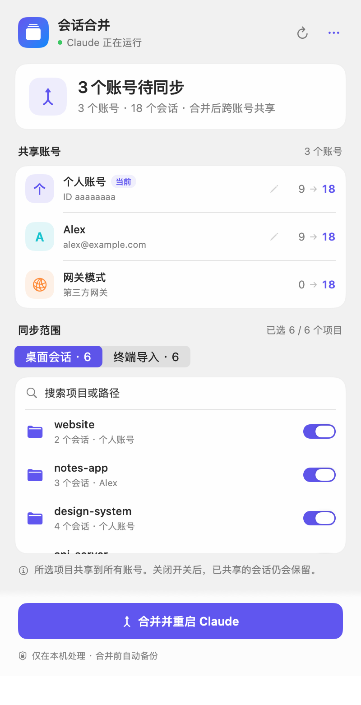
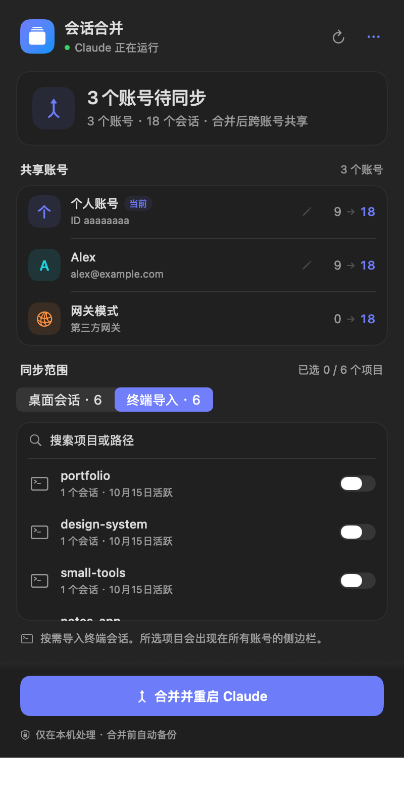

# 会话合并 · Session Share

一个原生 macOS 菜单栏工具，让不同 Claude Desktop 账号与网关模式的侧边栏共享本机 Code 会话。点顶部菜单栏图标查看账号、选择项目，确认后关闭 Claude、备份和合并列表，再重新打开。

个人开发的实验性工具，与 Anthropic 无隶属关系。使用桌面版尚未公开的本地数据格式，应用更新后可能需要适配。提供源码与实验性 App 下载，建议先用数据副本验证。MIT 开源。

<p>
  
  
</p>

截图使用脚本生成的虚构账号和项目。

## Features · 已实现

- [x] **顶部菜单栏常驻**：SwiftUI 面板、不占 Dock、待同步图标提示，支持设置登录时启动。
- [x] **账号对应关系**：展示名字、邮箱、当前登录标记和会话数量变化；无法识别时显示账号 ID，可设置备注。
- [x] **项目选择**：按本地项目文件夹展示会话数量及账号来源，记住同步开关。
- [x] **网关目录支持**：同时处理 `Claude` 与 `Claude-3p` 中已经存在的账号目录。
- [x] **终端会话导入**：按项目选择只在终端使用过的会话，默认关闭。
- [x] **重启前确认**：Claude 运行时合并需要确认，显示会话将被中断；没有改动时无需重启。
- [x] **备份与撤销**：写入前备份，最多保留 3 份；支持撤销最近一次合并，跳过之后又被修改的文件。
- [x] **删除与归档同步**：合并删除标记，按每个账号实际持有的会话重建归档索引。
- [x] **纯 Swift 引擎**：扫描、合并、设置与撤销原生执行，无需 Node.js、Bun 或 magpie。
- [x] **本地处理**：合并引擎没有网络请求，不操作 Cookies、钥匙串或登录 token。
- [x] **开发接口**：命令行、JSON 状态接口、基于文件大小和修改时间的终端扫描缓存，以及 34 项原生 Swift 自动化测试。

## Roadmap · 计划中的 Feature

以下为后续方向，尚未实现，不代表当前版本已支持。

- [ ] **账号 × 项目同步范围**：分别选择来源账号、目标账号与项目，支持只同步到某个账号或网关。目前项目开关会影响所有账号。
- [ ] **会话级选择与预览**：搜索项目、展开单个会话，查看标题、来源和待执行的改动。
- [ ] **备份版本管理**：展示版本时间、改动摘要和占用空间，可配置只保留 1～3 份。
- [ ] **按项目还原指定版本**：预览冲突并重新计算归档索引，避免覆盖之后的工作。目前只支持撤销最近一次合并。
- [ ] **同步规则预设**：保存不同工作场景的项目与账号选择。
- [ ] **网关兼容检查**：检测旧会话模型与网关模型名是否匹配，提供明确的调整提示。
- [ ] **账号资料识别改进**：优先使用明确的非凭证资料来源；新增数据来源时提供用途说明与用户选择，保留 ID 和备注兜底。
- [ ] **桌面版格式兼容检查**：发现不支持的版本或数据布局时给出清楚提示。
- [x] **可靠性加强**：设置顺序保存、丢弃过期扫描结果、原生引擎串行执行与跨进程锁、撤销后重建归档索引。
- [ ] **故障回滚**：写入中途失败时自动恢复整次操作。
- [ ] **发布与交互验证**：完整菜单栏操作、辅助功能、登录启动和重启后的会话打开测试；提供签名、公证和可下载安装包。
- [ ] **Intel Mac 构建验证**：当前仅打包 Apple Silicon 版本。

欢迎通过 [Issues](https://github.com/qingye-lab/session-share/issues) 反馈问题和功能建议。请使用演示数据，避免上传真实会话、邮箱或凭证。

## 下载安装

纯 Swift **v0.5.0 临时预览版**：[下载页](https://github.com/qingye-lab/session-share/releases/tag/v0.5.0)。

- **[DMG 安装包](https://github.com/qingye-lab/session-share/releases/download/v0.5.0/Session-Share-0.5.0-macOS-arm64.dmg)**：打开后把「会话合并.app」拖到 Applications。
- **[ZIP 压缩包](https://github.com/qingye-lab/session-share/releases/download/v0.5.0/Session-Share-0.5.0-macOS-arm64.zip)**：解压后把 App 拖进「应用程序」。
- 两种包均包含 **[首次打开方法.txt](packaging/首次打开方法.txt)**，解释未公证版本被 macOS 拦截时如何在系统设置中添加例外，无需终端命令。

适用 **Apple Silicon（M 系列）Mac、macOS 14+**。使用 App 无需 Xcode、Node.js、Bun 或 magpie；备份使用 macOS 自带的 `/usr/bin/tar`。

应用为临时签名，**没有 Apple 公证**。若 macOS 阻止打开，先尝试打开一次，再到「系统设置 → 隐私与安全性 → 仍要打开」确认。请核对下载来源；不需要关闭 Gatekeeper。安装后从屏幕顶部菜单栏图标打开面板，程序不显示 Dock 图标。

## 环境与构建

当前构建目标为 **Apple Silicon Mac、macOS 14+**，构建只需要 Xcode / Swift 工具链，无第三方包依赖。

```bash
git clone https://github.com/qingye-lab/session-share.git
```

在仓库目录内测试、构建：

```bash
./tests/run.sh
```

```bash
./build.sh
```

生成 `dist/会话合并.app`，拖进「应用程序」后打开。程序是本地临时签名，没有 Developer ID 签名或公证。菜单栏右上角「⋯」可设置登录时启动和退出。

## 面板交互

- **账号**：分组展示名字、邮箱、当前登录标记，以及「当前数量 → 合并后数量」。点铅笔编辑备注；只有内容更新时显示更新图标。
- **同步范围**：在桌面会话与终端导入间切换，按项目名称或完整路径搜索，查看当前来源的已选项目数量。
- **桌面会话**：点项目行或开关选择共享。关闭后停止新增副本，已经同步过去的会话保留，已有副本仍会更新。
- **终端导入**：默认关闭，选中后导入该项目中符合识别规则的终端会话。
- **即时反馈**：连续切换项目会按顺序保存，重新计算完成前暂停合并按钮；读取失败可重试，警告可展开查看。
- **底部操作区**：固定显示合并、打开或同步完成状态。重启与撤销确认在原位展开，Esc 取消；⌘R 重新读取。
- **系统适配**：原生浅色与深色外观、半透明材质，并尊重减少动态效果、减少透明度和增强对比度设置。
- **⋯ 菜单**：撤销上次合并、查看备份文件夹、登录时启动、退出。

合并会中断正在运行的 Code 会话，确认后才执行。程序通过系统接口请求 Claude 正常退出；引擎写入前再次检查。完成后会尝试发送系统通知。

## 数据与合并规则

Code 对话正文通常保存在 `~/.claude/projects/`；桌面版按账号保存侧边栏记录：

```text
~/Library/Application Support/Claude/claude-code-sessions/<account>/<org>/
~/Library/Application Support/Claude-3p/claude-code-sessions/<account>/<org>/
```

工具合并侧边栏记录，不修改对话正文。仅扫描已存在的账号目录；切换到一个新账号或网关配置后，应先打开桌面版让它生成目录。

- 同一会话以 `lastActivityAt` 较新的副本为准，再用文件修改时间打破平局。
- 删除标记会传播到所有账号；删除之后又被使用、时间较新的会话会保留。
- 归档状态跟随会话，归档索引按目标目录实际拥有的会话重建。
- 导入的终端会话使用稳定 ID，避免重复导入；默认采用普通权限模式。
- 来源账号表示工具第一次看到该会话时持有它的账号，**不保证就是最初创建账号**。已经手动同步过的数据可能有多个来源。
- 账号名字和邮箱取自 Claude Code 配置中的 `oauthAccount` 资料字段；读不到时显示 ID，不读取桌面版 IndexedDB 或登录存储。备注保存在工具自己的设置里。

工具状态在 `~/Library/Application Support/session-share/`，包括设置、来源记录、扫描缓存、撤销清单和备份。这些文件可能含账号资料、会话标题和项目路径，请按个人数据保管。

## 备份与撤销

只有真正写入时才备份，最多保留 3 个压缩包。备份涵盖两个数据目录中的 `claude-code-sessions/`，不包含完整对话正文。

「⋯ → 撤销上次合并」根据改动清单恢复文件：合并后再次修改过的文件会跳过，新建且不在清单中的文件不会删除。撤销前也会做备份。取消项目开关后再合并，可避免撤销的副本重新被补回。

当前没有图形化选择旧备份的功能。直接解压 tar 包只是覆盖文件，**不会移除备份后新增的文件，不等于完整回滚**。优先使用内置撤销；需要手工修复时应先退出 Claude，另外保存当前目录，并逐项检查差异。

## 限制与验证状态

- 已通过 34 项原生引擎测试，覆盖旧版 JSON 设置、稳定会话 ID 与 tar 备份撤销兼容性；并在演示数据上与旧 JS 引擎比较状态和终端导入预览。
- 菜单栏完整点击流程、真实退出与重开、导入会话继续对话和登录时启动仍需实际使用验证。
- 普通云端聊天、云端 Code 会话、Cowork 会话与账号授权的连接器不在合并范围内。
- 列表同步不会迁移账号权限、连接器授权、配额或服务端资源。网关模式中的继续对话还取决于模型和工具兼容性。
- 未识别的归档索引格式会阻止写入；无法解析的单个会话文件会跳过并警告。写入中途失败可能留下部分改动，请保留备份。
- 当前终端扫描依赖启发式规则，可能遗漏含特殊内容或来源的会话。发现问题请提供脱敏样本。

## 命令行

构建独立的原生 CLI：

```bash
./scripts/build-cli.sh
```

预演（仅更新工具缓存，不写桌面版会话列表）：

```bash
build/session-share status
```

输出 JSON 状态：

```bash
build/session-share state
```

先正常退出 Claude，再合并：

```bash
build/session-share sync-all
```

撤销最近一次合并（同样要求先退出 Claude）：

```bash
build/session-share undo
```

CLI 的 `set desktop|terminal <文件夹> on|off` 与 `remark <UUID> [备注]` 和菜单栏共享设置。CLI 不自动退出或重开 Claude；完整重启交互在菜单栏 App 中执行。

## 开发与演示数据

- `NativeMerge.swift`：合并、项目选择、账号资料、备份、撤销。
- `NativeTranscripts.swift`：分块扫描大体积 JSONL 与扫描缓存。
- `NativeStorage.swift`：私有文件写入、哈希与跨进程锁。
- `Engine.swift`：保持稳定的 Snapshot 数据接口，在串行队列执行原生引擎。
- `scripts/DemoData.swift`：生成虚构账号和项目。
- `tests/NativeEngineTests.swift`：独立临时目录中的原生测试。

构建 DMG、ZIP 与 SHA-256 校验文件：

```bash
./scripts/package.sh
```

GitHub Actions 会运行原生测试和打包，并把安装包保存为工作流 Artifact；目前未自动进行 Developer ID 签名、公证或创建 Release。

生成演示数据（目标必须为空目录）：

```bash
./scripts/demo-data.sh build/demo-home
```

渲染预览，数据读取限制在演示目录：

```bash
SESSION_SHARE_ROOT="$PWD/build/demo-home" SESSION_MERGE_PREVIEW="$PWD/build/panel.png" "dist/会话合并.app/Contents/MacOS/SessionMerge"
```

可加 `SESSION_MERGE_PREVIEW_LOOK=dark`、`SESSION_MERGE_PREVIEW_TAB=terminal` 或 `SESSION_MERGE_PREVIEW_PHASE=confirmMerge`。

旧版 `settings.json`、`origins.json`、扫描缓存、删除标记与 `last-run.json` 继续兼容，原有备份可撤销；不需要手动迁移个人数据。

## License

[MIT](LICENSE) © 2026 qingye-lab
